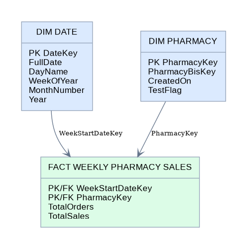
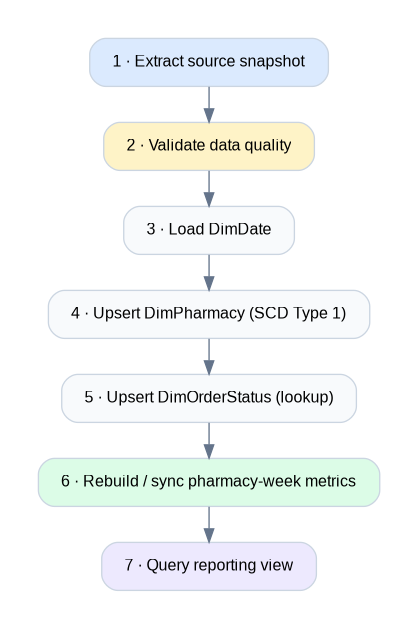
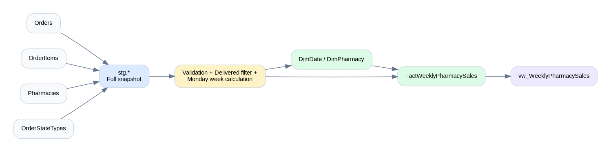

# Pharmacy Sales Analytics Data Warehouse

**An end-to-end SQL Server data warehousing project built with Kimball dimensional modeling and a dedicated staging area.**

<p align="center">
  
</p>

    

## Contents

- [Project overview](#project-overview)
- [Business requirements](#business-requirements)
- [Solution architecture](#solution-architecture)
- [Dimensional model](#dimensional-model)
- [Slowly changing dimensions: Type 1](#slowly-changing-dimensions-type-1)
- [ETL workflow](#etl-workflow)
- [Repository structure](#repository-structure)
- [Getting started](#getting-started)
- [Data quality and testing](#data-quality-and-testing)
- [Assumptions and limitations](#assumptions-and-limitations)
- [Documentation and diagrams](#documentation-and-diagrams)
- [Future enhancements](#future-enhancements)

## Project overview

Operational pharmacy systems record **orders, order items, pharmacies, and order statuses** as transactions. This project transforms those records into a small, understandable dimensional data warehouse designed for weekly pharmacy sales analysis.

It is a standalone **educational portfolio project** inspired by the structured engineering workflow and documentation style. Its business case and solution architecture are different: **Kimball + Staging**

### Business requirements

> **How much did each pharmacy sell in each week, and how many delivered orders contributed?**

| Design decision | Definition |
| --- | --- |
| **Fact grain** | Exactly one row per pharmacy per reporting week |
| **Reporting week** | Monday through Sunday |
| **Time basis** | Week of `Orders.CreatedOn`, **not** actual delivery date |
| **Eligible orders** | Orders whose **current** status is `Delivered`, with at least one valid item |
| **TotalSales** | `SUM(OrderItems.Price * OrderItems.Quantity)`; rounded to 2 decimals at the weekly total |
| **TotalOrders** | `COUNT(DISTINCT Orders.Id)` |
| **Test pharmacies** | Retained in the fact, filtered out of the reporting view |

For example, one pharmacy and one Monday-starting week produce **one fact row**, regardless of the number of orders or line items in that week.

## Solution architecture


The pipeline is organized into four logical layers:

| Layer | Responsibility | SQL objects |
| --- | --- | --- |
| **Source** | Operational transactions | `OnlinePharmacyDB.dbo.*` |
| **Staging** | Full source snapshots without weekly aggregation | `stg.Orders`, `stg.OrderItems`, `stg.Pharmacies`, `stg.OrderStateTypes` |
| **Kimball warehouse** | Validated dimensions and weekly aggregated fact | `dbo.DimDate`, `dbo.DimPharmacy`, `dbo.DimOrderStatus`, `dbo.FactWeeklyPharmacySales` |
| **Reporting** | Analyst-friendly, non-test-pharmacy output | `dbo.vw_WeeklyPharmacySales` |

**Why staging?** It decouples extraction from dimensional transformation, enables validation before loading the warehouse, and makes ETL issues easier to trace. The staging tables are **replaceable snapshots**, not a historical raw-data archive.

**Why Kimball?** A star schema makes the business question and the fact grain explicit, while keeping reporting queries straightforward.

The implementation uses SQL Server stored procedures and T-SQL; it does not require SSIS, Airflow, Spark, or cloud services.

## Dimensional model



### Fact table — `dbo.FactWeeklyPharmacySales`

| Column | Role | Meaning |
| --- | --- | --- |
| `WeekStartDateKey` | Primary + foreign key | Monday's `DimDate.DateKey` |
| `PharmacyKey` | Primary + foreign key | `DimPharmacy.PharmacyKey` |
| `TotalOrders` | Measure | Distinct qualifying delivered orders |
| `TotalSales` | Measure | Sum of item prices × quantities |

The composite primary key `(WeekStartDateKey, PharmacyKey)` enforces the **one pharmacy × one week** grain.

### Dimensions

| Dimension | Grain | Purpose |
| --- | --- | --- |
| `dbo.DimDate` | One calendar day | Provides calendar attributes; the weekly fact points to the **Monday** row |
| `dbo.DimPharmacy` | One pharmacy | Identifies and describes pharmacies; stores the `TestFlag` |
| `dbo.DimOrderStatus` | One source status | ETL lookup for identifying `Delivered`; **not directly linked** to the weekly fact |

**Key design note:** This course implementation uses **source-derived integer keys** for pharmacy and status, rather than independently generated warehouse surrogate keys. The date key is a `YYYYMMDD` integer.

## Slowly changing dimensions: Type 1

The pharmacy and order-status dimensions use **SCD Type 1** for supported changing attributes.

**SCD Type 1 means overwriting the existing row when a source attribute changes.** It does **not** keep prior attribute versions or insert a new historical row for each change.

For example, suppose a pharmacy's `TestFlag` changes after a later source extraction:

| Load | PharmacyKey | PharmacyBisKey | TestFlag |
| --- | ---: | --- | ---: |
| Before | 101 | `PHARMACY-101` | 0 |
| After | 101 | `PHARMACY-101` | 1 |

The same dimension row is **updated** rather than duplicated. As a result, the reporting view may stop showing that pharmacy when `TestFlag = 1`, while the underlying weekly fact remains intact.

**Implemented behavior:**

- **Existing business entity:** `UPDATE` attributes in place when their values change.
- **New business entity:** `INSERT` a new dimension row.
- **Historical versions:** None; no `ValidFrom`, `ValidTo`, or `IsCurrent` versioning.
- **Fact refresh:** Weekly metrics are re-synchronized separately and should not be confused with SCD Type 1 dimension maintenance.

Implementation: [`04_load_dim_pharmacy.sql`](03_scripts/04_warehouse/04_load_dim_pharmacy.sql) and [`05_load_dim_order_status.sql`](03_scripts/04_warehouse/05_load_dim_order_status.sql).

> SCD Type 1 is a deliberate **current-state reporting** choice, not a historical/audit solution. It will not answer "what did this pharmacy's attributes look like six months ago?"

## ETL workflow



1. **Extract:** Copy source records into the staging schema.
2. **Validate:** Reject invalid values or missing references before dimensional loads.
3. **Load date dimension:** Populate calendar dates used by fact keys.
4. **Sync pharmacy dimension:** Apply **SCD Type 1** updates and insertions.
5. **Sync status lookup:** Refresh the current order status labels.
6. **Sync weekly fact:** Aggregate valid currently-Delivered orders by pharmacy and Monday week, update existing rows, add new rows, and remove obsolete pharmacy-weeks.
7. **Report:** Query the semantic view, excluding test pharmacies.



**Full snapshot is intentional:** the pipeline recalculates weekly facts from the complete staged source. Supplying partial data could incorrectly remove fact rows. Changes to current order status, prices, or quantities can change prior creation-week totals on later runs.

## Repository structure

```text
pharmacy-sales-analytics-dwh/
├── setup/
│   └── README.md                      # Prerequisites and setup instructions
├── datasets/
│   └── 01_create_sample_source.sql    # Synthetic source dataset
├── docs/
│   ├── architecture/                  # Architecture and star-schema notes
│   ├── data/                          # Data dictionary and source mapping
│   ├── requirements/                  # Business requirements and project plan
│   ├── notion-import/                 # Optional Notion-ready Markdown and CSV
│   ├── images/                        # GitHub-ready architecture visuals
│   ├── data_architecture.drawio       # Editable architecture diagram
│   ├── data_flow.drawio               # Editable data-flow diagram
│   ├── data_models.drawio             # Editable ERD
│   └── etl.drawio                     # Editable ETL workflow
├── scripts/
│   ├── 01_setup/                      # Database and schema
│   ├── staging/                    # Staging tables and source extraction
│   ├── 03_quality/                    # Pre-load validation
│   ├── 04_warehouse/                  # Dimensions, fact, loading procedures
│   ├── 05_reporting/                  # Semantic reporting view
│   ├── 06_orchestration/              # Pipeline procedure and execution
│   └── README.md                      # Exact deployment order
├── tests/
│   ├── 01_data_quality/              # Structural and business data checks
│   ├── reconciliation/            # Staging-to-fact numerical comparison
│   ├── 03_integration/               # Change scenarios on demo data
│   └── README.md
├── CONTRIBUTING.md
└── README.md
```

## Getting started

### Prerequisites

- Microsoft SQL Server supporting `CREATE OR ALTER PROCEDURE` / `CREATE OR ALTER VIEW` (SQL Server 2016 SP1 or later)
- SQL Server Management Studio (SSMS) or `sqlcmd` (understands `GO` batch separators)
- Permission to create the **sample** and **warehouse** databases on a disposable instance

### 1. Prepare the demo source

On a **disposable SQL Server instance** where `OnlinePharmacyDB` does not exist, run:

```text
01_datasets/01_create_sample_source.sql
```

This creates synthetic sample tables and records. **Do not run the sample-source setup against an existing operational database.**

### 2. Deploy the warehouse objects

Follow [`03_scripts/README.md`](03_scripts/README.md) in numbered order, starting at:

```text
03_scripts/01_setup/01_create_database.sql
03_scripts/01_setup/create_staging_schema.sql
03_scripts/staging/01_create_staging_tables.sql
...
03_scripts/06_orchestration/01_create_pipeline.sql
```

The intermediate scripts create tables and stored procedures; **creating a procedure is not the same as running the ETL**.

### 3. Execute the full pipeline

Run:

```text
03_scripts/06_orchestration/execute_pipeline.sql
```

Or execute the stored procedure after deployment:

```sql
USE WeeklySalesPharmacyDWH;
GO
EXEC dbo.usp_Run_WeeklyPharmacyETL;
GO
```

### 4. Explore the output

```sql
USE WeeklySalesPharmacyDWH;
GO

SELECT
    Pharmacy,
    WeekStart,
    WeekEnd,
    TotalOrders,
    TotalSales
FROM dbo.vw_WeeklyPharmacySales
ORDER BY WeekStart, Pharmacy;
GO
```

### Sample report screenshot

The repository contains a provided example image of the weekly report:


*Example visual only. Actual figures must be verified against a successful local SQL Server run.*

## Data quality and testing

Three complementary test categories help evaluate the warehouse:

| Test category | Location | What it checks |
| --- | --- | --- |
| **Data quality** | [`01_data_quality`](04_tests/01_data_quality/01_quality_checks.sql) | Primary/foreign key integrity, calendar and business grain, invalid inputs |
| **Reconciliation** | [`reconciliation`](04_tests/reconciliation/01_reconcile_weekly_sales.sql) | Independently calculated staging totals vs. weekly fact measures |
| **Integration** | [`03_integration`](04_tests/03_integration/01_integration_tests.sql) | Pipeline behavior after synthetic order, price, or status changes |

Read the [test execution guide](04_tests/README.md) first. Integration tests modify **synthetic source data** inside a rollback transaction and must run **only on the disposable demo database**.

> **Verification status:** SQL scripts and tests are provided, but an end-to-end SQL Server execution was **not performed in this environment**. No tests are claimed to have passed until actually run and recorded.

## Assumptions and limitations

- Weekly assignment uses **order creation time**, even though eligibility requires current `Delivered` status; this is *not* delivery-date revenue.
- Current-status filtering means historical weekly values can change as orders become Delivered or are corrected.
- Sales include order item price × quantity only; no separate delivery fees, tax, discounts, refunds, or currency conversion unless represented in the source item price.
- Orders without items do not contribute to the fact.
- `DimDate` is daily, but the weekly fact references its Monday row.
- Source capture consists of several table reads and is **not guaranteed** to be a single consistent point-in-time snapshot under concurrent writes.
- Dimension attributes are Type 1; change history is not retained.
- No CDC, scheduler, BI dashboard, or production monitoring is included.

## Documentation and diagrams

The diagrams below are included as **editable `.drawio` files**. Open them in [diagrams.net](https://app.diagrams.net/).

| Diagram | Preview | Editable file |
| --- | --- | --- |
| High-level architecture | [PNG](docs/images/architecture-overview.png) | [draw.io](docs/data_architecture.drawio) |
| Data flow | [PNG](docs/images/source-to-target.png) | [draw.io](docs/data_flow.drawio) |
| Star schema | [PNG](docs/images/star-schema.png) | [draw.io](docs/data_models.drawio) |
| ETL workflow | [PNG](docs/images/etl-workflow.png) | [draw.io](docs/etl.drawio) |

Additional resources: [Business requirements](docs/requirements/business-requirements.md) · [Project plan](docs/requirements/project-plan.md) · [Architecture notes](docs/architecture/architecture.md) · [Star schema notes](docs/architecture/star-schema.md) · [Data dictionary](docs/data/data-dictionary.md) · [Source-to-target mapping](docs/data/source-to-target-mapping.md) · [Naming conventions](docs/naming-conventions.md) · [Notion-ready task board](docs/notion-import/).

## Future enhancements

- Incremental extraction / CDC instead of full source replacement
- Source-consistent extraction and pipeline audit logging
- CI automation that executes tests against SQL Server
- SCD Type 2 for attributes requiring historical tracking
- BI dashboards and operational scheduling
- Explicit business rules for delivery-date attribution, taxes, and refunds

---

**Project focus:** reproducible, clearly documented SQL Server data engineering with explicit business grain, traceable transformations, and testable results.
