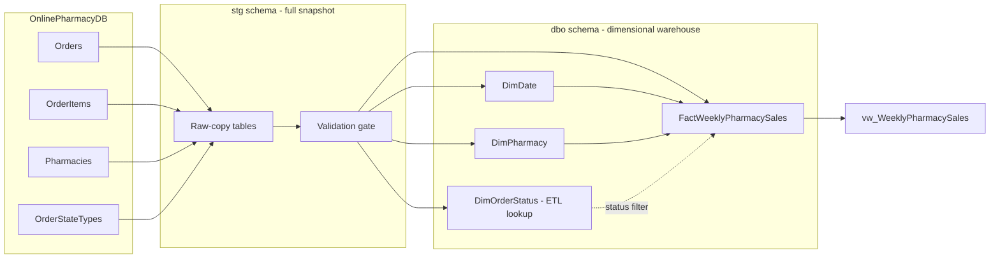

# Kimball-oriented architecture

This is **source → staging → dimensional DWH → reporting**.

- Staging is replaceable, temporary-purpose, row-level source snapshot; not a historical archive.
- The validation gate rejects missing references and unconvertible/invalid item values; it does not silently discard rows.
- Dimensions are Type-1 (overwritten for current pharmacy/status properties). Their primary keys are source-derived for this course assignment, not independently generated surrogate keys.
- `DimOrderStatus` supports ETL lookup but has **no** FK from weekly fact: status is filtered to Delivered before aggregation.
- The full snapshot recalculation removes obsolete pharmacy-week rows; this requires a complete, reasonably consistent source snapshot.
- ETL invocation uses a SQL Server application lock for one active run, transactions for mutation blocks, and rethrows failures.
- SQL Server instance does not provide a guaranteed point-in-time snapshot unless transaction isolation/source capture configuration ensures it; the staging SELECTs do not themselves guarantee consistency under concurrent source writes.
